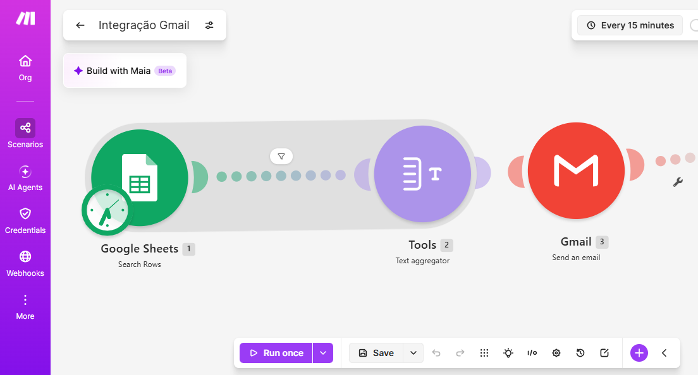
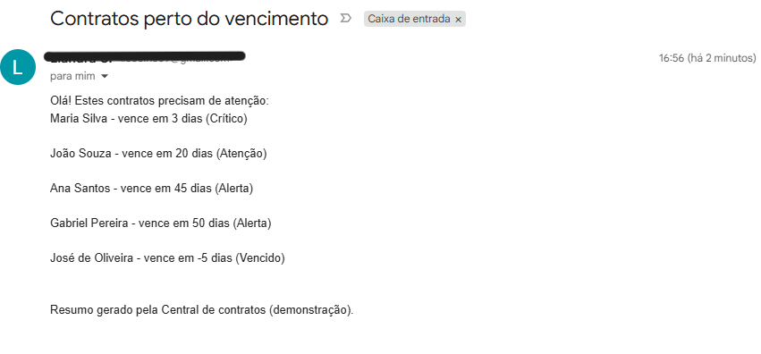
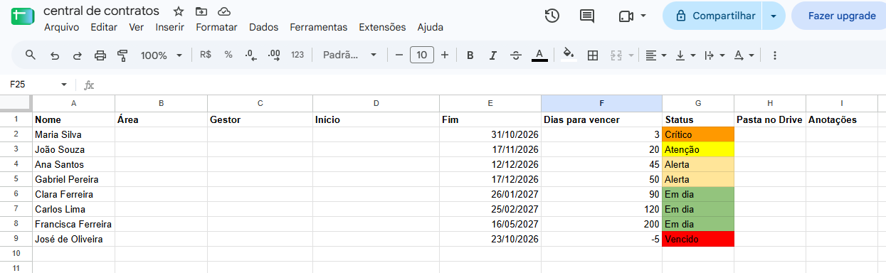
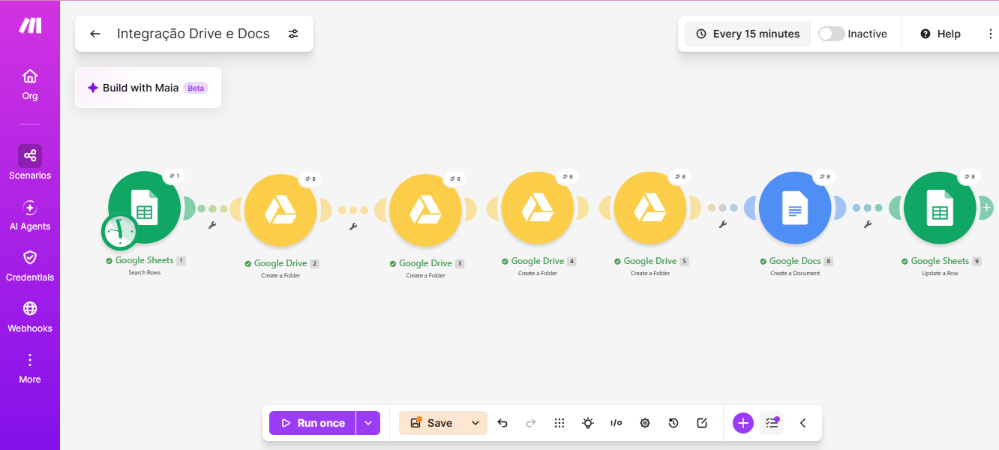
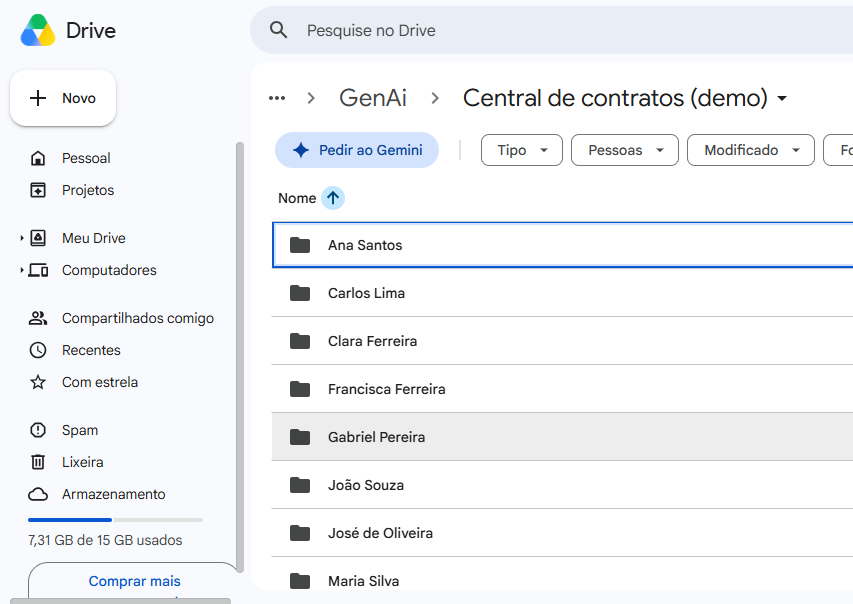
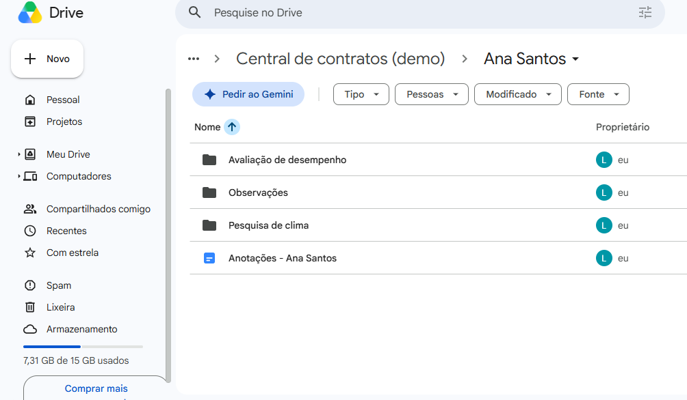
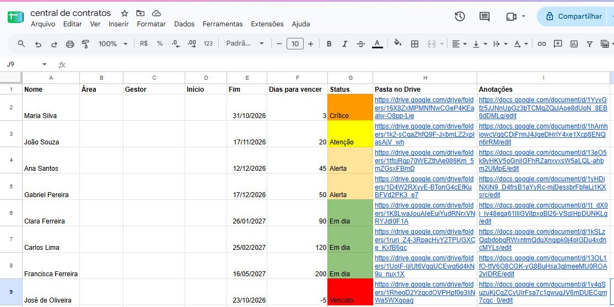

# Central de contratos de estágio

Projeto de demonstração. Todos os dados e nomes são fictícios.
Tempos medidos em cenário simulado.

## Problema
Contratos de estágio vencem, e as informações de cada pessoa
(anotações, avaliação de desempenho, pesquisa de clima) ficam espalhadas.

## O que o projeto faz
1. Um fluxo no Make lê a planilha e envia por e-mail a lista dos contratos
   perto do vencimento (alerta, atenção, crítico ou vencido).
2. Outro fluxo cria, para cada pessoa, uma pasta no Google Drive com
   3 subpastas (avaliação de desempenho, pesquisa de clima e observações)
   e um documento de anotações. Os links voltam para a planilha.

## Ferramentas
Make · Google Planilhas · Google Drive · Google Docs · Gmail

## Como funciona
Planilha → Make lê as linhas → filtra por status ou por pasta vazia →
cria pastas e documentos → grava os links de volta na planilha.

## Resultado (medido em cenário simulado)
- Manual: 15 minutos por pessoa em média
- Com o fluxo: 1 minuto por pessoa (rodar no Make e conferir)
- Economia: 14 minutos por pessoa
- Estimativa: 10 pessoas novas por mês (valor estimado, usado para simplificar o cálculo)
- Economia estimada: cerca de 2,3 h/mês e 28 h/ano

## Prints

### Fluxo 1: alerta de vencimento

### Fluxo 2: pastas e anotações por pessoa

### Resultado final

## Limites
Demonstração com 8 pessoas fictícias. O fluxo roda manualmente
para não gastar créditos do plano gratuito do Make.
